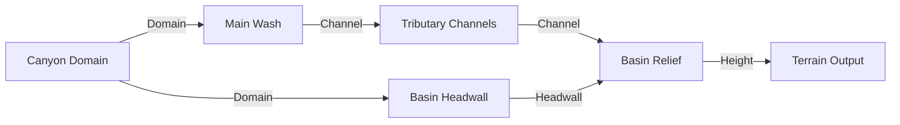

# Terrain surface materials

## Rebuild the Dry Canyon graph

Open **Nodal Terrain → Dry Canyon** to inspect the complete recipe, or start with **Blank graph** and make these connections. Every node is available in the node palette.

### Build the landform

Add the five nodes below from **Landforms**. Their default settings reproduce the template. If your graph already contains the single **Dry Canyon** node, select it and click **Expand Dry Canyon** in Properties to carry its settings and outgoing wires into the five-node layout.

1. Connect **Canyon Domain** to **Main Wash**, **Main Wash** directly to **Basin Relief · Channel**, and **Basin Relief · Height** to **Terrain Output · Height**. This gives you a single open wash. Domain controls the seed and scale. Main Wash controls the bends.
2. Insert **Tributary Channels** between Main Wash and Basin Relief. Both wires use **Channel**. Set **Left Bank Spacing** to **0.29** and **Right Bank Spacing** to **0.37**. Smaller spacing adds more side valleys on that bank.
3. Branch **Canyon Domain · Domain** into **Basin Headwall · Domain**, then wire **Basin Headwall · Headwall** into **Basin Relief · Headwall**. Setback positions the upper wall. Basin Relief sets the final relief in metres, rim strength and fluting depth.

### Add the erosion-driven surface

1. Add **Erosion Maps**, **Rock Exposure**, and **Wash Coverage**. Wire **Erosion → Rock Exposure · Erosion**, **Flow → Wash Coverage · Flow**, and **Deposition → Wash Coverage · Deposition**. Rock Exposure combines removed material with slope and elevation. Wash Coverage favors sediment and drainage on gentler ground.
2. Add three **Canyon Material** nodes. Set their ground types to **Scrub soil**, **Bedded rock**, and **Wash gravel**. Connect **Wash Coverage → Scrub soil · Wash** to thin the scrub in drainage channels.
3. Add a **Material Blend**. Wire soil to **A**, rock to **B**, and **Rock Exposure** to **Mask**. A mask of zero selects A and a mask of one selects B.
4. Add a second **Material Blend**. Wire the first blend to **A**, gravel to **B**, and **Wash Coverage** to **Mask**. Connect its **Surface** output to **Terrain Output · Surface**.

The template opens with a 384 × 384 Tile erosion bake. All three map sockets read the same simulation that displaces the terrain. To see what one map contributes, connect **Deposition** directly to the second blend's **Mask**. Gravel will follow sediment accumulation alone. Rewiring the material reuses the bake. Editing the connected landform regenerates it. For the template's simulation settings on a blank project, start from the Canyon erosion settings, choose High quality and CPU, and set strength to **0.55**.

The local pack contains 22 CC0 source textures and nine derived recipes. The prepared 512, 1024 and 2048 pixel maps, mipmaps, height sources, thumbnails, catalog and [attribution](../public/textures/terrain/pbr/ATTRIBUTION.md) live in `public/textures/terrain/pbr`. Builds copy this directory into the web output and the Electron resources. Runtime rendering does not contact Poly Haven or ambientCG.

Run `npm run materials:fetch` to download or resume the official sources into `.cache/materials`. Run `npm run materials:build` to regenerate the prepared pack, and `npm run materials:verify` to check files, hashes and the recipe manifest. `npm run build` verifies the source pack and the web output. `npm run desktop:package` builds the web output and packages it for Windows.

In the editor, select **Local PBR Library**, then choose a preset or assign individual roles. The raw source textures remain available. **Pale dune sand** and **Bright powder snow** are named adaptations of the brown sand and gray snow scans; their albedo multipliers appear in the catalog and credits. The sand and snow biome defaults use these recipes. The palette control applies to the historical custom atlas and is hidden for the PBR library.

The Surface Textures **Scale** control ranges from 0.1× to 5×. It multiplies texture repeat frequency. Material selection follows broad climate, height, shoreline and slope signals; fine procedural color noise does not choose materials. Custom Materials now default to **Original Texture Colors**, including existing projects that lack the new setting. Turn it off only when palette recoloring is wanted. The Local PBR Library always uses the source albedo.

**Blend Textures** controls how strongly neighboring ground materials mix. **Transition Width** (0–1, default 0.5) separately widens the slope, altitude, canyon, desert and shoreline masks that bring those materials together. It also fades the second material out and back in when its identity changes, removing the dune-to-rock jump without another texture sample. Set it to 0 for nearly the earlier mask widths or increase it to soften abrupt desert rock/sand boundaries. Both controls apply to the custom atlas and local PBR library without changing terrain geometry.

The PBR renderer uses world anchored triplanar coordinates. Detail sampling changes continuously to a fixed macro scale as its projected pixel footprint grows. Explicit texture gradients are taken before material and paint branches. Role blending uses symmetric weights, so switching the dominant role on a slope does not create a color jump. The source height, roughness, normal and AO maps share each patch transform. The imported snow AO is deliberately softened for terrain rendering, and scanned roughness controls the remaining specular response.

Snow now blends continuously over the selected ground materials using its altitude and slope coverage. It does not enter the top-two ground-material ranking, which previously made snow appear abruptly when its weight overtook another material. The same transition applies to the custom texture atlas and the local PBR library; manual snow paint retains its authored coverage.

For a reproducible snowline render in Edge, run `node tools/surface-browser-check.mjs --snow-preview` while the Vite development server is running on port 6064. The check uses a controlled height gradient and writes its screenshot and shader diagnostics to `output/surface-qa/`.

For the desert transition, run `node tools/surface-browser-check.mjs --desert-preview`. It renders the same slope gradient with **Blend Textures** at 1 and saves **Transition Width** 0 and 1 images for comparison.

The three PBR node examples are **PBR Alpine**, **PBR Canyon** and **PBR Jungle / Marsh**. Personal imports persist in IndexedDB and travel in portable `.ptrterrain` exports. Cloud sync refuses projects with local texture dependencies.

For validation, run `node tools/surface-appearance-check.mjs` against a local Vite server on port 6064 to render snow, sand and a sloped rock sample. Run `node tools/surface-browser-check.mjs --quick` to compile the real terrain shader, or omit `--quick` to compile terrain, paint, planet and baking. Results are written under `output/surface-qa`. The automated browser checks use Edge/ANGLE on Windows; Safari and mobile WebGL 2 have not been tested here.
